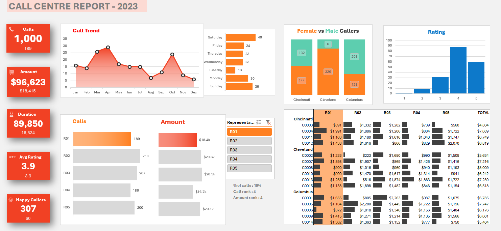

# 📊 Call Centre Performance Dashboard | 2023

<p align="center">
  <strong>DATA ANALYTICS • BUSINESS INTELLIGENCE • INTERACTIVE REPORTING</strong>
</p>

<p align="center">
  
  
  
  
</p>

## 📌 Project Overview

The **Call Centre Performance Dashboard** is an interactive Excel dashboard developed to analyse call centre operations and customer service performance for 2023.

The dashboard provides insights into call volume, call duration, revenue, customer ratings, representative performance, and regional performance. It helps understand operational trends and evaluate customer service effectiveness through visual reporting.

## 📷 Dashboard Preview

<p align="center">
  
</p>

## 🎯 Business Objectives

- Monitor overall call centre performance.
- Analyse monthly and weekday call trends.
- Understand customer demographics and satisfaction.
- Compare individual representative performance.
- Evaluate regional call centre activity.
- Support data-driven business decisions.

## 📊 Key Performance Indicators (KPIs)

| KPI | Description |
|---|---|
| Total Calls | Total number of calls received |
| Total Amount | Overall amount generated |
| Call Duration | Total duration of calls |
| Average Rating | Average customer rating |
| Happy Callers | Number of satisfied callers |

## 📈 Dashboard Features

| Analysis | Description |
|---|---|
| Monthly Call Trend | Analyses call volume across months |
| Calls by Weekday | Identifies call activity by day of the week |
| Gender Analysis | Compares female and male callers |
| Customer Ratings | Shows the distribution of customer ratings |
| Representative Performance | Compares calls and amounts generated by representatives |
| Regional Analysis | Analyses performance across Cincinnati, Cleveland, and Columbus |

## 🎛️ Interactive Dashboard Functionality

The dashboard includes an interactive **Representative ID Slicer** with five representatives (R01–R05).

**How the slicer works:**

1. **Select a Representative:** Choose an ID from the slicer.
2. **Dynamic Updates:** Connected KPI cards, PivotTables and PivotCharts automatically update according to the selected representative.
3. **Performance Insights:** Explore the selected representative's call volume, amount, call trends, ratings and other connected metrics.
4. **Switch Representatives:** Select another representative to instantly view their performance.
5. **Reset Selection:** Clear the slicer selection to return to the overall call centre report.

**Note:** The Female vs. Male Callers chart displays overall caller demographics and is not connected to the Representative ID slicer.

## 🛠️ Tools & Technologies

- Microsoft Excel
- PivotTables and PivotCharts
- Excel Formulas and Functions
- Slicers
- Conditional Formatting
- Data Analysis and Visualization

## 📁 Repository Structure

```text
call-centre-performance-dashboard/
│
├── Dataset/
│   └── Portfolio project Raw Data.xlsx
│
├── Call_Centre_Performance_Dashboard.xlsx
├── README.md
└── call-centre-dashboard.png
```

## 📥 Project Resources

| Resource | Link |
|---|---|
| Excel Dashboard | [View / Download Dashboard](Call_Centre_Performance_Dashboard.xlsx) |
| Raw Dataset | [View / Download Dataset](Dataset/Portfolio%20project%20Raw%20Data.xlsx) |
| Dashboard Preview | [View Dashboard Image](call-centre-dashboard.png) |

**Note:** Download the Excel workbook and open it in Microsoft Excel to explore the dashboard and its interactive slicer functionality.

## 💡 Skills Demonstrated

- Data Analysis
- Data Cleaning and Preparation
- Excel Dashboard Development
- Data Visualization
- PivotTables and PivotCharts
- Interactive Reporting
- Business Performance Analysis

## 👨‍💻 About the Author

**Yogeswar Reddy**

B.Tech in Computer Science and Engineering

Aspiring Data Analyst | Python | SQL | Excel | Power BI

<p align="left">
  <a href="https://github.com/YogiReddy7396">
    
  </a>
</p>

---

<p align="center">
  <strong>Thank you for visiting this project!</strong>
</p>
